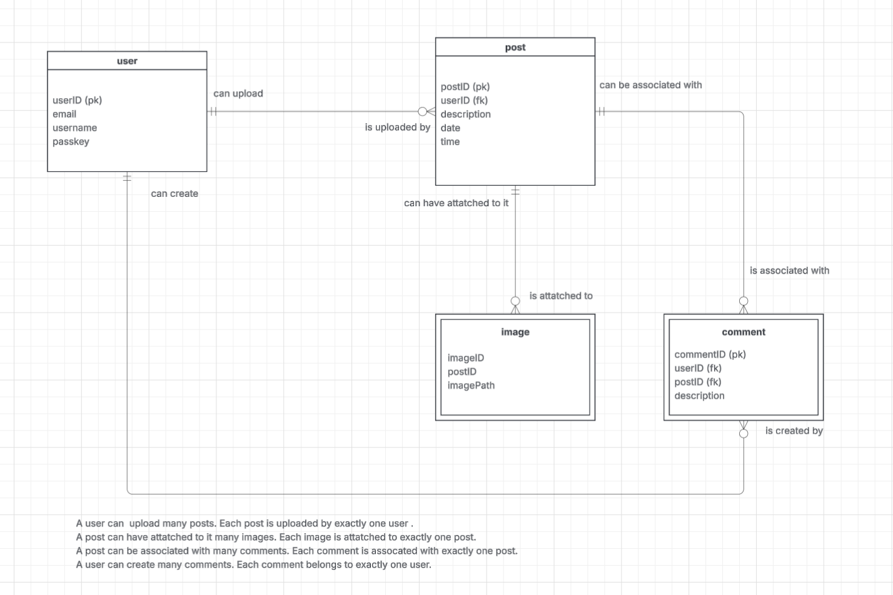
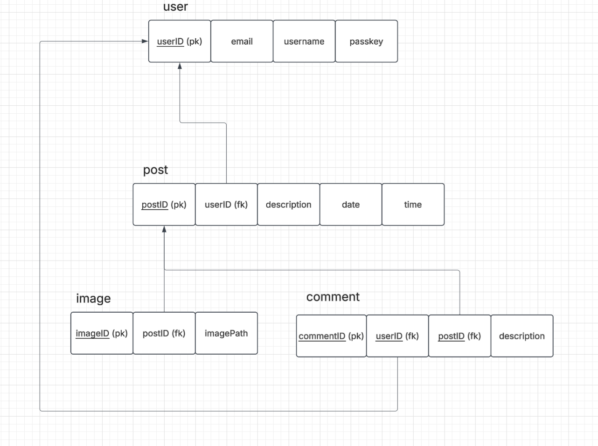

AstroWebsite
An astronomy website for people to learn about and share stellar captures! I plan on making a Astronomy website where community members can connect, chare captures, and ask for advice. The website will be a place for anyone no matter their knowledge in astrophotography.

Experienced photographers can share their captures and gear they used, and those looking to start with the hobby can look at realistic examples from different places with varying setups!

A user can post and comment if they have an account set up! They can also search for posts with specific telescopes, accessories, and celestial bodies captured (such as saturn, the moon, etc)

This is the entity relationship diagram (ERD). It shows the structure of the project's database. 

This is the relations diagram. It demonstrates the exact attributes which relate to another table. This diagram is in 3rd normal form. 
 